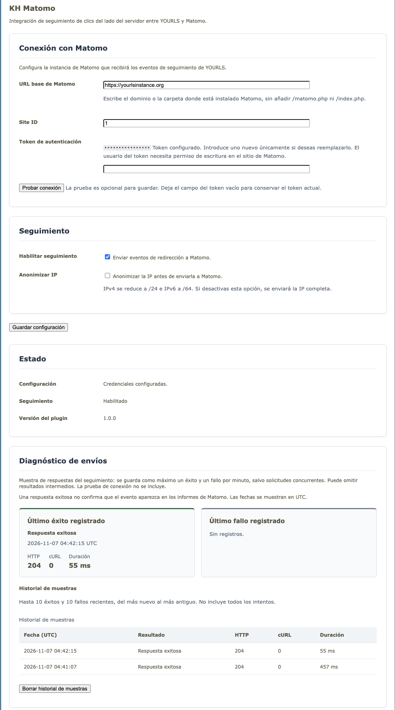
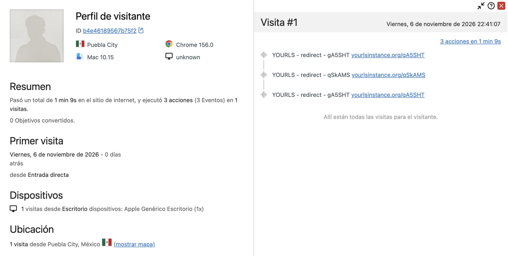

# KH Matomo for YOURLS

KH Matomo sends server-side click events from YOURLS to Matomo. It uses the
YOURLS redirect hook and Matomo's HTTP Tracking API; no JavaScript is needed on
the destination website.

## Features

- Tracks valid short-link redirects as Matomo events.
- Stores configuration in YOURLS and keeps the saved token masked.
- Lets administrators test the Matomo connection separately from saving.
- Preserves the existing token when the token field is left blank; entering a
  new token replaces it.
- Anonymizes visitor IP addresses by default before sending them to Matomo.
- Keeps redirects working even when Matomo is unavailable.

## Requirements

- YOURLS 1.10.x (development environment: YOURLS 1.10.6).
- PHP 8.1 or newer with the cURL extension.
- Matomo Cloud or Matomo 5/6 self-hosted.
- A Matomo token with write or administrator permission for the selected site.

## Install

1. Copy the plugin directory into `user/plugins/kh-matomo/` so `plugin.php` is
   at the plugin directory root.
2. Activate **KH Matomo Tracker** in the YOURLS Plugins page.
3. Open **Matomo Tracker** from the YOURLS Plugins page.

## Configure

Enter the Matomo base URL, Site ID, and authentication token. The base URL is
the Matomo domain, optionally followed by its installation directory. Do not
append `/matomo.php` or `/index.php`; the plugin adds the correct endpoint.

Examples:

- `https://analytics.example.com`
- `https://example.com/matomo/`
- `https://example.matomo.cloud/`

You can use **Test connection** to check your settings before saving. Leave the
token field blank to keep the saved token, or enter a new one to replace it.
The connection test accepts both site write and administrator permissions.

Turn on **Enable tracking** and save your settings to start sending redirect
events to Matomo. IP anonymization is on by default: IPv4 addresses are masked
to `/24` and IPv6 addresses to `/64` before they are sent. Turning it off sends
the visitor's full IP address to Matomo.





## Event data

Each tracked redirect sends:

| Matomo field | Value |
|---|---|
| Event category | `YOURLS` |
| Event action | `redirect` |
| Event name | Short-link keyword |
| Action URL | Short URL visited |
| Action custom variable | Original destination URL, named `YOURLS destination` |
| Referrer | Request referrer, if present |
| User-Agent | Visitor's User-Agent, if present |
| Client IP | Masked by default |

To verify a click immediately, select the configured site in Matomo and inspect
**Visitors → Visits Log / Live**. Expand a visit and look for the `YOURLS`
event. Standard reports may update later through Matomo archiving. In a local
YOURLS environment, the action URL will use the local host (for example,
`localhost:8080`); a production environment uses its configured public YOURLS
URL.

## Delivery and privacy

Tracking runs synchronously before YOURLS sends the redirect response. The
request has a 500 ms connection timeout and a 1 second total timeout. A slow or
unavailable Matomo service can add up to that bounded wait, but tracking errors
do not prevent the redirect. Delivery is best effort and is not guaranteed.

The destination URL is included in Matomo as a custom variable. Avoid tracking
links whose query strings contain information that should not be stored in
analytics.

## Code layout

- `plugin.php`: plugin entry point and YOURLS hook registration.
- `includes/admin.php`: settings page, validation, and save flow.
- `includes/settings.php`: defaults and YOURLS option persistence.
- `includes/tracker.php`: redirect event construction and IP anonymization.
- `includes/matomo-api.php`: Matomo Reporting API and Tracking API requests.

## Delivery diagnostics

The settings page shows the last recorded successful response and failure from
redirect tracking, with timestamps displayed using the YOURLS timezone and
date format, HTTP status, cURL error number, and request duration. Connection tests do not update these diagnostics. HTTP 2xx
confirms an endpoint response, not that an event appears in Matomo reports.

Two bounded YOURLS options are stored, one per outcome. Each is updated
at most once per minute for sequential requests; concurrent requests may write
together. These are samples, not exact last-attempt times or availability
statistics. Intermediate errors may be omitted. No token, keyword, destination,
referrer, User-Agent, IP, or response body is stored. Existing samples remain
visible when tracking is disabled or connection settings change.

Persistence happens during the redirect and adds database work on sampled
requests, with no additional network requests. Diagnostic storage failures do
not change the tracking result.

### Bounded sample history

The diagnostic cards are followed by a history of up to ten successes and ten
failures, sorted newest first. History is saved inside the existing outcome
options in the same sampled write, with no additional write per redirect.
Concurrent requests can overwrite samples; this is not an audit log. Existing
card-only data remains compatible; history begins with the next sampled write.
The nonce-protected clear action removes history while retaining cards and
sampling timestamps. Samples may reappear as new clicks are tracked.

## Translations

The plugin uses YOURLS' native gettext functions and the `kh-matomo` text
domain. The `languages` directory includes English (`en_US`), Spanish for
Spain (`es_ES`) and Mexico (`es_MX`), plus the translation template
`kh-matomo.pot`. The plugin loads `kh-matomo-<locale>.mo` using the locale
configured in YOURLS. After editing a `.po` file, rebuild its `.mo` file with:

```bash
msgfmt --check --check-format \
  --output-file=languages/kh-matomo-en_US.mo \
  languages/kh-matomo-en_US.po
```

Use the corresponding locale name for other catalogs and keep each `.po` source
alongside its compiled `.mo` file.

## Update notice

The settings page checks GitHub for new stable releases and lets you know when
an update is available. Drafts and prereleases are excluded. Results are cached
for 24 hours, or 2 hours if the check fails. Updates must be installed manually;
the plugin does not download or install them.
