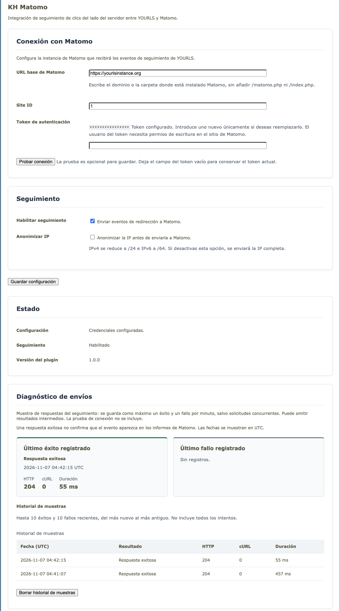
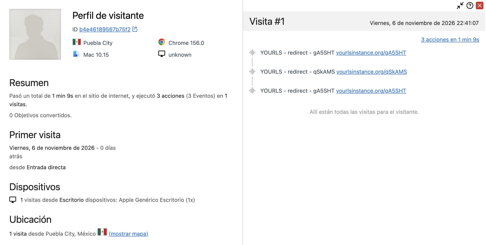

# Configuration guide

Open **Matomo Tracker** from the YOURLS Plugins page, set up the connection,
choose what to track, and click **Save settings**. Settings apply to the whole
YOURLS installation and are kept when you deactivate or update the plugin.

The panel uses the language configured in YOURLS. This guide uses the English
labels and gives the original Spanish label for each setting.

## Settings at a glance

| Setting | Default | Required |
|---|---|---|
| Matomo base URL | Empty | Yes, to save or test the connection |
| Site ID | Empty | Yes, to save or test the connection |
| Authentication token | Empty | Yes on first setup; afterward, a blank field keeps the saved token |
| Enable tracking | Off | Turn on to send events |
| Track links not found | Off | Optional; also requires Enable tracking |
| Anonymize IP | On | Optional; applies to both event types |

## Matomo base URL

**Spanish label:** URL base de Matomo.

Enter the HTTPS address where Matomo is installed. Subdirectories and a
trailing slash are fine:

```text
https://analytics.example.com
https://example.com/matomo/
https://example.matomo.cloud/
```

Don't paste a report URL from your browser, and don't add `/index.php` or
`/matomo.php`. The plugin adds `/index.php` when it checks the connection and
`/matomo.php` when it sends events. The URL can't contain credentials, query
parameters, or a fragment.

HTTPS is required so the authentication token is protected in transit. The
panel rejects HTTP URLs, and the plugin also refuses to send anything if a
non-HTTPS URL was written directly to the database. TLS certificates are always
verified, and redirects from the configured endpoint are not followed.

## Site ID

**Spanish label:** Site ID.

Enter the positive whole number Matomo uses to identify your site, such as `1`.
This is the site's ID, not its domain or the name of your YOURLS installation.
The token you use must have write or admin access to this site.

Every event from this installation goes to this Site ID. Changing it affects
future events only. It doesn't move existing Matomo data or clear the local
delivery diagnostics.

## Authentication token

**Spanish label:** Token de autenticación.

Use a token from a dedicated Matomo user that has write access to only the
selected site. Admin access works, but it isn't necessary.

- **First setup:** enter a token before saving or testing.
- **Later:** leave the field blank to keep the saved token.
- **To replace it:** enter the new token and save.

You can test a replacement token before saving it. Testing never overwrites the
stored token. The saved token appears as a mask and is never filled back into
the password field.

The token is stored unencrypted in the YOURLS database, so protect database
access and backups. It is sent in HTTPS POST requests, never in the URL, and it
never appears in the local delivery diagnostics.

## Enable tracking

**Spanish label:** Habilitar seguimiento. **Default:** Off.

This is the main switch for sending events. When it's on, each valid short-link
redirect sends an event with the category `YOURLS`, the action `redirect`, and
the keyword as the event name. The action URL is the short URL, built from the
address configured in YOURLS.

Turning it off stops both redirect and missing-keyword tracking. Your
connection settings, your missing-keyword preference, and the existing
diagnostics are kept. You don't need to test the connection to change this
checkbox.

Tracking runs before the redirect, with a 500 ms connection timeout and a
1-second total timeout. A slow Matomo server can delay the redirect slightly,
but a tracking failure never cancels it. Failed deliveries aren't retried.

## Track links not found

**Spanish label:** Registrar enlaces no encontrados. **Default:** Off.

Turn this on to find mistyped or deleted short links that still receive
requests. It also needs **Enable tracking**. Each eligible request sends the
category `YOURLS`, the action `keyword_not_found`, and the missing keyword as
the event name. These events carry no destination data.

### Which requests are eligible?

A request must reach YOURLS' missing-keyword hook and meet all of these rules:

- It uses the GET method.
- It has one non-empty keyword segment, with an optional trailing slash.
- The keyword is 100 bytes or shorter. Longer keywords are skipped, not
  truncated.
- The keyword matches YOURLS' keyword character rules without any changes.
- It contains no whitespace, control characters, slashes, or backslashes.

Query strings and fragments are stripped from the keyword. They are not stripped
from the referrer, which is collected separately. Random-looking keywords are
accepted: the plugin doesn't assume a generated-keyword length or block file
extensions. The 100-byte limit is conservative for Unicode keywords.

| Request | Result (assuming tracking is on and quota is available) |
|---|---|
| GET `/a8Kp2Z` | Eligible if all its characters are allowed |
| GET `/promo?source=email` | Recorded as `promo` |
| GET `/promo/` | Recorded as `promo` |
| GET `/assets/logo.png` | Skipped: more than one segment |
| GET `/archivo.php` | Eligible only if YOURLS allows the dot and every other character |
| HEAD `/promo` | Skipped: the method isn't GET |

Files that the web server or proxy serves or rejects directly never reach this
hook, and other plugins may handle a request before it gets there. The event
means YOURLS couldn't resolve the keyword at that point. It doesn't mean the
final response is an HTTP 404.

### Quota and scanners

The plugin reserves at most 30 delivery attempts per fixed 60-second window
across the whole installation. The limit is built in; there's no panel setting
for it. Failed deliveries use up quota too. A new window opens every minute, so
requests around a boundary can use capacity in two consecutive windows.

The quota is based on absolute time, regardless of the display timezone. A
non-blocking database lock protects reservations across workers that share a
database server. If the lock is busy or storage fails, the optional event is
skipped. The lock is released before the plugin contacts Matomo.

The quota doesn't apply to valid redirect events. It limits volume, but it
can't identify every bot: a scanner that uses valid-looking keywords can use up
the quota and cause legitimate missing-keyword requests to be skipped. The
plugin has no User-Agent bot filter and no exact count of discarded events.

### Fallback redirects

Recording or skipping an event never changes YOURLS' fallback behavior. With
Redirect Index, for example, a missing keyword can redirect to the site root and
then to that plugin's configured destination. KH Matomo doesn't record that
root redirect as a valid short-link click.

## Anonymize IP

**Spanish label:** Anonimizar IP. **Default:** On.

This applies to valid redirects and missing-keyword events alike. The plugin
gets the client IP from YOURLS' helper and masks it before sending it to
Matomo:

| Address | Example input | Sent with anonymization on |
|---|---|---|
| IPv4 | `192.0.2.123` | `192.0.2.0` (`/24`) |
| IPv6 | `2001:db8:abcd:1234:5678:90ab:cdef:1234` | `2001:db8:abcd:1234::` (`/64`) |

Turning it off sends the full client IP when it's valid. An invalid or
unavailable address is left out. The local diagnostics never store the client
IP. Anonymization doesn't remove sensitive values from destination or referrer
URLs.

## Test connection and save

**Test connection** (Spanish: Probar conexión) checks the current form values
against Matomo's Reporting API and accepts write or admin permission for the
selected Site ID. It doesn't send an event, change the diagnostics, or save
anything. A successful test confirms connectivity and permissions only. It
doesn't guarantee that events will show up in your reports.

**Save settings** (Spanish: Guardar configuración) validates the connection
fields locally and saves all options together. It doesn't require a connection
test and doesn't prove that Matomo is reachable. Changes apply to future
requests.

## Diagnostics, history, and quota notice

The success and failure cards sample delivery outcomes from both event types.
They don't show which event action was sent, and they don't confirm that the
event reached Matomo's reports. Each outcome is sampled at most once every 60
seconds for sequential requests, and concurrent requests may overwrite samples.
The history keeps up to ten successes and ten failures.

**Clear sample history** (Spanish: Borrar historial de muestras) removes only
the history. The cards and sampling timestamps stay, the missing-keyword quota
isn't reset, and nothing is deleted from Matomo.

The quota notice reads the existing reservation counter and shows whether the
latest recorded window reached its limit. It can describe an older window until
a new reservation updates it. It isn't a count of skipped requests: requests
over the limit don't write a new counter entry, and filtered requests don't
update the delivery diagnostics.

## Timezone and date format

KH Matomo has no timezone setting of its own. Diagnostic dates use YOURLS'
built-in helpers, so the Timezones plugin's settings apply when that plugin is
active. Otherwise, `YOURLS_HOURS_OFFSET` in `user/config.php` sets the offset,
which defaults to UTC. The default date format is `Y-m-d H:i:s` unless another
YOURLS filter changes it.

Only the display changes. Stored Unix timestamps, history order, quota windows,
diagnostic sampling, and update-check ages don't depend on the display
timezone. Matomo reports follow Matomo's own site and report settings.

## Destination data and updates

You can't choose which destination data is sent. Valid redirects send the full
original URL as a custom variable named `YOURLS destination`. Matomo needs the
CustomVariables plugin to process it (CustomDimensions alone won't work), and
it may truncate values to 200 characters. Before you enable tracking, check
your destination paths and query strings for sensitive information.

Update notices have no panel options either. Stable-release checks are cached
for 24 hours, or for 2 hours after a failure. Updates are installed manually.

Go back to the [README](../README.md) for installation, event examples, and
troubleshooting.

## Screenshots





